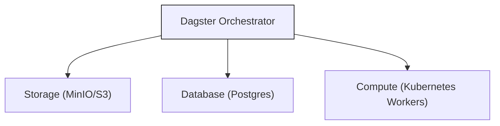

# Dagster in the Node
### A Local Orchestrator for Data Science

Dagster manages and monitors all workflows inside a single secure node.
It ensures data processing and model training are **reproducible** and **auditable**, keeping all data within organizational boundaries.

---

## Dagster's Core Concepts
### Ops and Assets

- **Ops:** Individual computation steps (e.g., clean data, train model).
- **Assets:** The datasets or models those steps produce.
- Dagster automatically builds a graph linking them, creating full **data lineage**.

**[Visual Placeholder]**
Diagram: "Raw Data → Cleaned Data → Model → Report"
Ops = steps, Assets = resulting data

---

## Dagster's Flexibility
### Schedules, Sensors, and Partitions

- **Schedules:** Automate recurring jobs (e.g., daily model retraining).
- **Sensors:** Trigger workflows when new data or events occur.
- **Partitions:** Manage data subsets (e.g., by date or region).
These enable automation, recovery, and precision control.

**[Visual Placeholder]**
Icons for calendar (schedules), bell (sensors), and grid (partitions) feeding into Dagster workflow.

---

## Execution
### Celery Workers and Shared Resources

- Dagster queues work via **RabbitMQ**, Celery executes it in worker pods.
- **Postgres:** Stores run metadata and logs.
- **MinIO:** Stores artifacts and outputs.
- Fully parallel, auditable, and isolated within the local environment.

**[Visual Placeholder]**
Flow diagram: "Dagster → RabbitMQ → Celery Workers → Postgres / MinIO."

---

## Dagster Pipes
### Run Any Language, Any Tool

- Use **R**, **Julia**, or any containerized environment.
- Outputs written to `/mnt` are collected automatically.
- Artifacts and logs uploaded to **S3/MinIO** with full traceability.

**[Visual Placeholder]**
Containers labeled R, Julia, Python writing to `/mnt`, Dagster uploading to S3.

---

## Benefits for Data Scientists and Controllers

- Unified framework for **traceable and reproducible** workflows.
- Automatic tracking of lineage, dependencies, and outputs.
- Works with any language or tool.
- Keeps execution **local, secure, and compliant**.

**[Visual Placeholder]**
Dagster at center surrounded by icons: "Traceable," "Flexible," "Secure," "Reproducible," "Auditable."

---

## Summary

- Dagster manages, tracks, and secures local workflows.
- **Assets & Ops:** Transparent data lineage.
- **Schedules, Sensors, Partitions:** Flexible automation.
- **Celery Workers:** Scalable execution.
- **Pipes:** Run any tool, any language.
- Enables compliant, transparent, reproducible data science.

**[Visual Placeholder]**
Simplified summary diagram with Dagster at the center and labels: "Track," "Automate," "Scale," "Audit," "Integrate."
