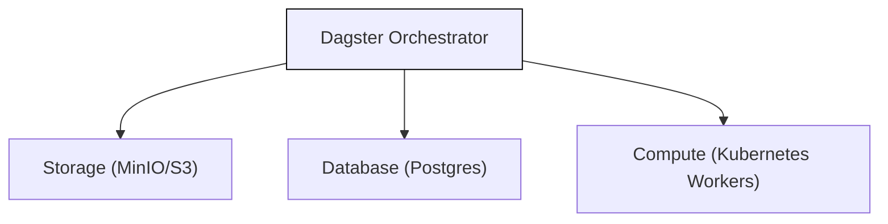

# Dagster in the Node
### A Local Orchestrator for Data Science

Dagster manages and monitors all workflows inside a single secure node.
It ensures data processing and model training are **reproducible** and **auditable**, keeping all data within organizational boundaries.

